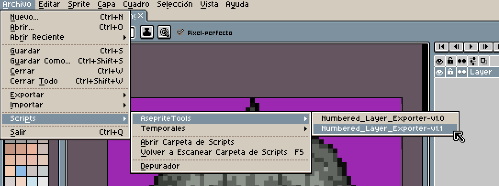

# Numbered Layer Exporter

### A Layer Exporting Tool for Aseprite

**Export individual layers from your Aseprite projects with ease.**

This tool is a custom Lua script designed to simplify the process of exporting individual layers from Aseprite projects.

Whether you need to export specific layers or organize your assets, this tool aims to make your workflow easier and more efficient.

---

## ✨ Features

- 📂 Export individual layers.
- 🗂️ Organize exported files into folders or a single directory.
- 🔢 Automatic layer numbering.
- 🖼️ Multiple export formats.
- 📏 Custom image scaling.
- 🎞️ Frame selection and export options.

*Features may vary depending on the installed version.*

---

## 📸 Preview

*Coming soon.*

---

## 📦 Installation

1. Download the desired version of the script.
2. Locate the Aseprite menu: File/Scripts/Open Scripts Folder.
3. Create a folder named `AsepriteTools`.
4. Copy the `.lua` file to the new directory.
5. Close the folder.
6. Return to Aseprite and go to: File/Scripts/Rescan Scripts Folder.
7. You will now see the updated list in the File/Scripts menu.

---

## 📖 Usage

1. Open your project in Aseprite.
2. Navigate to `File > Scripts`.
3. Select **Numbered_Layer_Exporter-v?.?**.
4. Configure the export options.
5. Choose your destination folder and start exporting.

---

## 📋 Requirements

- Aseprite 1.3 or compatible version.
- Lua scripting support.

---

## 📚 Version History

| Version | Release Date | Status | Description |
|---|---|---|---|
| [v1.1.0](./Numbered_Layer_Exporter-v1.1.0.lua) | 31/10/2026 | Sucess | An updated version introducing frame selection, allowing users to export a specific animation frame or all frames while retaining the original layer export options. |
| [v1.0.0](./Numbered_Layer_Exporter-v1.0.0.lua) | 25/10/2026 | Failure | An experimental Lua script that exports individual Aseprite layers with customizable folder organization, automatic numbering, multiple image formats, and scaling options. |

<!--| v1.0.0 | Coming soon / Pending | Initial release |-->
---

## ⚠️ Notes

This tool is an independent community resource and is not officially affiliated with Aseprite.

Please report bugs or suggest improvements through the repository's Issues section.